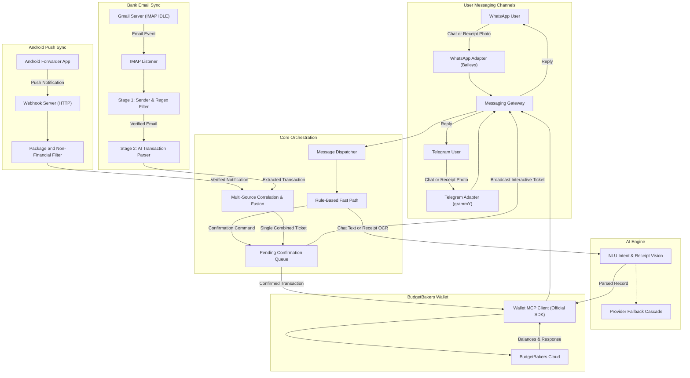

# AI Bookkeeper for BudgetBakers Wallet (WhatsApp & Telegram)

[](https://github.com/Churma16/wallet-mcp-budgetbakers-bot/actions/workflows/ci.yml) [](https://www.typescriptlang.org/) [](https://nodejs.org/) [](https://aistudio.google.com/) [](https://github.com/WhiskeySockets/Baileys) [](https://grammy.dev/) [](https://web.budgetbakers.com/settings/mcp-server) [](LICENSE)

An automated personal bookkeeping assistant for **WhatsApp** and **Telegram** integrated directly with BudgetBakers Wallet through the Model Context Protocol (MCP). The bot converts natural language messages and physical receipt photos into structured transactions, monitors bank notification emails and Android push alerts in real time, and provides an interactive confirmation queue before saving financial records.

### Example Messages

| What you send | What the bot does |
| :--- | :--- |
| *"Kopi kenangan 28rb bca"* | Records an expense under your BCA account categorized as Coffee/Food. |
| *"Lunch salad $8.50 cash"* | Records an expense under your Cash account with currency USD. |
| *"Gaji masuk 7.5jt ke Mandiri"* | Records an income transaction under your Mandiri account categorized as Salary. |
| Send physical receipt photo | Extracts merchant name, transaction date, line items, and total amount via AI vision. |
| *"Cek saldo rekening"* or *"Check balance"* | Retrieves current account balances directly from BudgetBakers Wallet. |
| *"Status budget bulan ini"* | Summarizes active budget limits and remaining headroom. |
| *"Riwayat pengeluaran makanan bulan ini"* | Queries transaction history with category and date filters. |
| *"Ya 1"* / *"Batal 1"* | Confirms or dismisses bank-synced email and push notification tickets. |

<details>
<summary><b>Table of Contents</b></summary>

- [Quickstart](#quickstart)
  - [Prerequisites](#prerequisites)
  - [1. Clone and Install](#1-clone-and-install)
  - [2. Configure Credentials](#2-configure-credentials)
  - [3. Verify Connectivity](#3-verify-connectivity)
  - [4. Start the Bot](#4-start-the-bot)
- [Everyday Usage & Commands](#everyday-usage--commands)
  - [Direct Chat Recording vs Confirmation Queue](#direct-chat-recording-vs-confirmation-queue)
  - [Supported Commands](#supported-commands)
  - [Interactive Bot Settings (Telegram)](#interactive-bot-settings-telegram)
- [Optional Inbound Sync](#optional-inbound-sync)
  - [Bank Email Synchronization (Gmail IMAP IDLE)](#bank-email-synchronization-gmail-imap-idle)
  - [Android Push Notification Forwarder](#android-push-notification-forwarder)
- [Architecture & Design](#architecture--design)
  - [Architecture Flow](#architecture-flow)
  - [Project Structure](#project-structure)
  - [Tech Stack & Libraries](#tech-stack--libraries)
- [Security, Privacy & Limitations](#security-privacy--limitations)
- [Disclaimer & Risk Notice](#disclaimer--risk-notice)
- [Release & Versioning](#release--versioning)
- [Community, Support & Contributing](#community-support--contributing)
- [License](#license)

</details>

---

## Quickstart

Get your bot running in four steps.

### Prerequisites

1. **Node.js**: Version 22.0.0 or higher.
2. **BudgetBakers Wallet MCP Token**: A Personal Access Token with scopes `records.create`, `records.read`, `accounts.read`, `categories.read`, and `budgets.read`. Generate one from [BudgetBakers MCP Server Settings](https://web.budgetbakers.com/settings/mcp-server) (see [Credential Setup Guide](docs/setup-credentials.md#wallet-mcp)).
3. **AI Provider Key**:
   - **Google Gemini** (tested primary provider): Obtain a free API key from [Google AI Studio](https://aistudio.google.com/app/apikey).
   - *Optional alternatives*: OpenRouter, Groq, Ollama, or OpenAI via OpenAI-compatible endpoints.
4. **Messaging Credentials (At least one required)**:
   - **WhatsApp**: Your international phone number (e.g. `6281234567890`) for `ALLOWED_PHONE_NUMBER`.
   - **Telegram**: Both a bot token from [@BotFather](https://t.me/BotFather) (`TELEGRAM_BOT_TOKEN`) and your numeric Telegram user ID from [@userinfobot](https://t.me/userinfobot) (`TELEGRAM_ALLOWED_USER_ID`). Usernames such as @username are not supported.

### 1. Clone and Install

```bash
git clone https://github.com/Churma16/wallet-mcp-budgetbakers-bot.git
cd wallet-mcp-budgetbakers-bot
npm install
```

### 2. Configure Credentials

The recommended way to configure the bot is the interactive setup wizard:

```bash
npm run setup
```

*(Tip: You can also run `npm run setup:dry-run` to preview the configuration without writing any files to disk).*

The wizard guides you step-by-step through:
- Connecting your BudgetBakers Wallet Personal Access Token.
- Choosing your primary AI provider (Google Gemini, OpenAI, Groq, OpenRouter, or local Ollama).
- Configuring your messaging channel (Telegram or WhatsApp) with strict access authorization.
- Regional preferences (English or Indonesian, default currency like `USD` or `EUR`, and auto-detected host timezone with support for major global city aliases).
- Optional bank/e-wallet email receipt monitoring with automated port, host, and email validation.

Alternatively, copy `.env.example` to `.env` and fill in the values manually:

```bash
cp .env.example .env
```

**Core configuration variables:**

| Variable | Description | Example |
| :--- | :--- | :--- |
| `WALLET_MCP_ACCESS_TOKEN` | Personal Access Token from BudgetBakers | `pat_...` |
| `AI_PROVIDER` | Active AI provider (`gemini`, `openrouter`, `groq`, `ollama`, or `openai`) | `gemini` |
| `GEMINI_API_KEY` | Gemini API key (if using Gemini) | `AIzaSy...` |
| `ALLOWED_PHONE_NUMBER` | Whitelisted WhatsApp phone number (E.164 without `+`) | `14155552671` |
| `TELEGRAM_BOT_TOKEN` | Bot token from @BotFather (if using Telegram) | `123456789:ABC...` |
| `TELEGRAM_ALLOWED_USER_ID` | Numeric Telegram user ID (if using Telegram) | `123456789` |

> [!IMPORTANT]
> The setup wizard defaults to international standards (`APP_LANGUAGE=en`, `DEFAULT_CURRENCY=USD`, and auto-detects your system timezone with global city aliases like `London`, `New York`, `Tokyo`, or `Jakarta`).
> If you live in Indonesia or prefer Indonesian regional settings, you can select `Bahasa Indonesia`, set `DEFAULT_CURRENCY=IDR`, and use `WIB` (`Asia/Jakarta`) directly in the wizard.
> For full variable documentation, see [.env.example](.env.example) and the [Setup and Diagnostics Guide](docs/setup-and-diagnostics.md).

> [!TIP]
> Operational preferences like AI models, category resolution mode, language, currency, timezone, and sync rules can also be customized interactively on the fly via `/settings` on Telegram without restarting the bot.

### 3. Verify Connectivity

Before starting, run the diagnostic doctor command to verify token scopes, AI credentials, and filesystem permissions:

```bash
npm run doctor
```

### 4. Start the Bot

Run in development mode with hot-reloading:
```bash
npm run dev
```

Or run for production:
```bash
npm start
```

- **WhatsApp**: A QR code displays in the terminal on first run. Open WhatsApp > **Settings** > **Linked Devices** > **Link a Device** and scan the QR code. Credentials are saved locally in `./auth_session` for automatic reconnection.
- **Telegram**: Open your bot in Telegram and send `/start` from your whitelisted user account.

---

## Everyday Usage & Commands

### Direct Chat Recording vs Confirmation Queue

The bot uses two distinct paths depending on where the transaction originates:

1. **Direct Chat & Receipt Photos (Immediate Recording)**:
   - When you send an expense shorthand (e.g., *"Kopi 25rb bca"*) or upload a receipt photo directly to the bot, the message is parsed and recorded immediately to BudgetBakers Wallet.
   - If account or category resolution is ambiguous, the bot asks for clarification in chat before committing the record.

2. **Inbound Email & Push Notifications (Interactive Confirmation Queue)**:
   - Transactions detected automatically via bank emails or Android push notifications are **not** written to Wallet immediately.
   - They are placed into an in-memory and disk-persisted pending queue and assigned a numbered ticket (`#1`, `#2`) broadcast to your messaging channel.
   - You review the ticket and reply `Ya 1` / `Yes 1` to commit the transaction, or `Batal 1` / `Cancel 1` to discard it.

### Supported Commands

| Scenario | Example (Indonesian / English) | Expected Result |
| :--- | :--- | :--- |
| **Expense Recording** | *"Kopi kenangan 28rb bca"* / *"Lunch salad $8.50 cash"* | Categorizes expense, resolves account, and records transaction in Wallet. |
| **Detailed Note** | *"Bensin pertamax 50rb bca, note: rest area km 57"* | Records expense with custom note and proper category. |
| **Income Recording** | *"Gaji masuk 7.5jt ke Mandiri"* / *"Salary $3500 into Checking"* | Categorizes as income/salary and records to specified account. |
| **Receipt OCR** | Send a photo of a physical paper receipt | Extracts merchant, items, amount, and date via AI vision, then records expense. |
| **Confirm Ticket** | *"Ya 1"* / *"Catat #2"* or *"Yes 1"* / *"Save #2"* | Confirms and records ticket `#1` or `#2` from the pending queue. |
| **Bulk Confirm** | *"Ya semua"* / *"Catat semua"* or *"Yes all"* / *"Save all"* | Records all pending transaction tickets in order. |
| **Cancel Ticket** | *"Batal 1"* / *"Batal semua"* or *"Cancel 1"* / *"Cancel all"* | Dismisses transaction tickets from the pending queue. |
| **Account Balances** | *"Cek saldo rekening"* or *"Check balance BCA"* | Queries Wallet MCP and lists current account balances. |
| **Budget Limits** | *"Status budget bulan ini"* or *"Budget status"* | Summarizes spending progress against active BudgetBakers budgets. |
| **Transaction History** | *"Riwayat"* / *"History"* or *"5 transaksi terakhir"* | Fetches the latest recorded transactions. |
| **Filtered History** | *"Riwayat pengeluaran makanan bulan ini"* or *"history bca yesterday"* | Composes filters across category, account, type, and date range in a single query. |
| **Paginated History**| *"Riwayat bca hal 2"* or *"history 5 oldest"* | Navigates history pages with deterministic sorting. |
| **Text Search** | *"Cari kopi"* or *"search starbucks"* | Searches transaction notes and merchants with case-insensitive keyword matching. |
| **Bot Settings** | `/settings` or *"pengaturan"* | *(Telegram only)* Opens 2-level interactive inline keyboard to customize AI models, categories, language, currency, and sync options on the fly. |

### Interactive Bot Settings (Telegram)

For Telegram users, runtime behavior can be customized on the fly without editing `.env` or restarting the container. Send `/settings` or type `pengaturan` to open an interactive 2-level inline keyboard menu:

- **AI Model & Fallbacks**: Switch candidate Gemini models (e.g. `gemini-3.5-flash-lite`, `gemini-3.8-flash`) or OpenRouter/custom models, toggle fallback chains, and adjust request timeouts.
- **Category Resolution Mode**: Toggle between `hybrid` (rule context + AI), `llm` (pure AI classification), or `rule` (deterministic matching).
- **Language & Regional Preferences**: Change bot language (`id` / `en`), default currency (`IDR`, `USD`, `EUR`, `SGD`), and timezone (`Asia/Jakarta`, `UTC`, `Asia/Singapore`).
- **Email Sync & Anti-Flood**: Adjust email lookback window (`10m`, `30m`, `60m`, `120m`) and message queue dispatch interval (`1s`, `2s`, `3s`, `5s`).
- **Diagnostics & Reset**: Configure daily log retention (`3d` to `30d`), toggle financial payload debugging, or reset overrides back to system/`.env` defaults.

> [!NOTE]
> All custom settings are stored in `auth_session/app-settings.json`. Credentials (API keys, bot tokens, passwords, and user whitelist IDs) remain strictly isolated in `.env` and can never be modified through chat.

---

## Optional Inbound Sync

> [!TIP]
> **Want to add support for your bank or wallet?** Check out the [Adding Providers Guide](ADDING_PROVIDERS.md) to add rules yourself, or open an issue with a sanitized sample and we'll add it for you.

### Bank Email Synchronization (Gmail IMAP IDLE)

The bot can monitor bank and e-wallet notification emails in real time via IMAP IDLE:

- **Supported Providers**: Bank Mandiri (Livin), Bank Jago, BCA, Flip, Grab, GoPay, OVO, DANA, Alfagift, and ShopeePay.
- **Two-Stage Filtering**:
  1. *Stage 1 (Rule-based)*: Validates headers, sender domains, and regex signatures while discarding promotional emails, OTPs, and login alerts without spending AI tokens.
  2. *Stage 2 (AI Extraction)*: Formats verified financial bodies into structured transaction payloads.
- **Setup**: Set `EMAIL_SYNC_ENABLED=true` in `.env` with your Gmail address and 16-character Google App Password. See [Credential Setup Guide](docs/setup-credentials.md#gmail-imap) for details.

### Android Push Notification Forwarder

If you use an Android device, transactions from supported banking apps (BCA, Mandiri Livin, BRImo, BNI wondr, blu, Jenius, SeaBank, GoPay, OVO, DANA, ShopeePay) can be pushed directly to the bot:

- **Companion App**: Built for the lightweight open-source forwarder (`codes.churma.walletforwarder`).
- **Webhook Endpoint**: Embedded HTTP server listening on `/api/webhook/notification` protected by Bearer token authentication (`NOTIFICATION_WEBHOOK_SECRET`).
- **Smart Correlation**: Automatically fuses notifications with incoming email receipts to prevent duplicate queue tickets when both email and push alerts arrive for the same transaction.

---

## Architecture & Design

### Architecture Flow



### Project Structure

The codebase is organized into vertical domain slices and cross-cutting infrastructure:

```
src/
├── app.ts                 # Thin composition root (context assembly and pipeline dispatching)
├── brain/                 # AI Domain: providers (Gemini, OpenRouter, Groq), prompts, parsers, clarification
├── cli/                   # Tooling: setup wizard, doctor diagnostics
├── config/                # Configuration: environment schema, notification rules
├── core/                  # Orchestration: AppContext, message dispatcher, action handlers, pending queue
├── email/                 # Email Domain: IMAP listener, bank rules, multi-source correlation
├── gateway/               # Gateway Domain: WhatsApp, Telegram, Console messaging adapters & coordinator
├── i18n/                  # Localization: dictionaries (en, id) and human message formatters
├── lib/                   # Infrastructure: Pino logger, resilience backoff, text formatters
├── wallet/                # Wallet Domain: BudgetBakers MCP client (official SDK), records, history, cache
└── index.ts               # Application entry point and process lifecycle management
```

### Tech Stack & Libraries

- **Language & Runtime**: TypeScript 5.x on Node.js 22+ via `tsx`
- **AI / NLU Engine**: Agnostic AI engine with primary support for Google Gemini via `@google/genai`, plus fallback options for OpenRouter, Groq, Ollama, and OpenAI via OpenAI-compatible endpoints.
- **Messaging Gateways**:
  - WhatsApp: `@whiskeysockets/baileys` (Multi-device WhatsApp Web socket API)
  - Telegram: `grammy` (Official Telegram Bot API framework)
- **MCP Client**: Official Model Context Protocol Client (`@modelcontextprotocol/client`) targeting BudgetBakers Wallet MCP Server
- **Email Synchronization**: `imapflow` (IMAP IDLE push events) and `mailparser` (RFC 822 stream parsing)
- **Logging**: `pino` with rotating daily file logs and clean console output

---

## Security, Privacy & Limitations

- **Security Policy & Vulnerability Reporting**: For supported versions, trust boundaries, and instructions on how to report a vulnerability privately, read our [Security Policy](SECURITY.md).
- **Self-Hosted, Direct Communication**: This is a self-hosted client application with no intermediary proxy servers. Your financial data travels directly between your machine, your chosen AI provider, and the BudgetBakers MCP server. Note that AI parsing and receipt OCR do require sending message text or images to your configured AI provider as part of the API call.
- **Strict Sender Whitelist**: Incoming messages from unapproved phone numbers or Telegram accounts are rejected immediately before reaching the AI or MCP layers.
- **Local Multi-Device Sessions**: WhatsApp connection tokens and cryptographic keys are stored in the local `./auth_session` folder and excluded from version control.
- **Tested Providers vs Community Support**: Google Gemini is the primary and actively tested AI provider for this project. Support for alternative providers (OpenRouter, Groq, Ollama, OpenAI) is implemented via standard OpenAI-compatible endpoints, but community testing and benchmarks are welcome.
- **Unofficial WhatsApp Protocol Notice**: This project uses Baileys to connect via WhatsApp Web protocols. Baileys is an unofficial library and is not endorsed or supported by Meta Platforms, Inc. Automating WhatsApp carries an inherent risk of phone number bans or temporary suspensions. For a setup using an official API without account suspension risks, use the included **Telegram adapter** (official Bot API) or pair with a secondary WhatsApp number.

---

## Disclaimer & Risk Notice

- **Financial & Data Accuracy**: This software is provided "as is", without warranty of any kind. AI extraction (NLU and Vision OCR) may produce inaccurate, incomplete, or unexpected results. Users are solely responsible for reviewing and verifying all financial records before and after logging. The author accepts no liability for financial losses, misrecorded expenses, budget discrepancies, or damages.
- **Credential & Inbox Security**: Users are solely responsible for securing their local `.env` configuration, Google App Passwords, and MCP tokens. Never commit credentials to version control.
- **Trademarks & Non-Affiliation**: Product names, trademarks, and brands (BudgetBakers, Bank Mandiri, Bank Jago, GoPay, OVO, DANA, ShopeePay, WhatsApp, Meta, Telegram, Google) belong to their respective owners. Mention in this repository is strictly for compatibility and descriptive purposes.

---

## Release & Versioning

This project follows [Semantic Versioning](https://semver.org/) and [Conventional Commits](https://www.conventionalcommits.org/):

- `feat(...)`: Introduces a new capability (minor version bump).
- `fix(...)`: Patches a bug (patch version bump).
- `docs(...)`: Documentation updates.
- `refactor(...)`: Code refactoring without behavior change.
- `chore(...)`: Routine dependency or build maintenance.

Every pull request and push to `main` triggers automated CI running TypeScript compilation and Vitest suites. Stable releases are published on demand via GitHub Actions. For detailed developer guidelines, see [CONTRIBUTING.md](CONTRIBUTING.md).

---

## Community, Support & Contributing

- **Discussions & Ideas**: Have questions, setup issues, or feature ideas? Join [GitHub Discussions](https://github.com/Churma16/wallet-mcp-budgetbakers-bot/discussions).
- **Bug Reports**: Open an issue on [GitHub Issues](https://github.com/Churma16/wallet-mcp-budgetbakers-bot/issues). Free-form descriptions in English or Indonesian are welcome.
- **Contributing**: Please review [CONTRIBUTING.md](CONTRIBUTING.md) for testing guidelines and pull request standards. We especially welcome sample test cases for additional bank email formats, multi-currency receipts, and alternative local AI model benchmarks.

---

## License

This project is licensed under the [MIT License](LICENSE).
